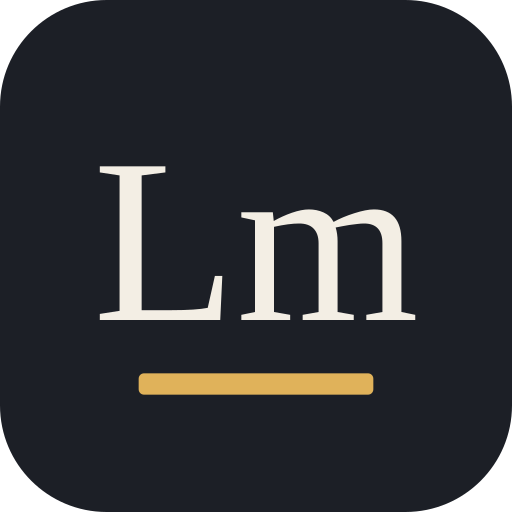
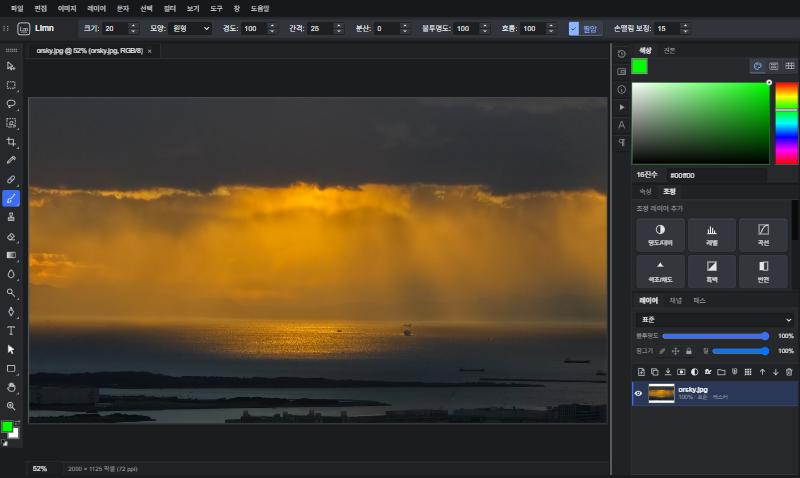

<div align="center">



# Limn

### 상상을 이미지로 담다

포토샵을 쓰던 손 그대로 쓸 수 있는 Windows 이미지 편집기

<br>



</div>

<br>

## 한눈에 보기

| | |
|---|---|
| **무엇인가요** | 레이어, 보정, 리터칭, AI 기능을 갖춘 이미지 편집 프로그램 |
| **누구를 위한 건가요** | 포토샵이 손에 익었지만 구독료가 부담스러운 사람 |
| **어디서 쓰나요** | Windows 10 · 11 |
| **무엇이 다른가요** | 도구 위치, 단축키, 메뉴 이름이 포토샵과 같아서 따로 익힐 게 거의 없어요 |

<br>

## 만들게 된 이유

사진을 찍고 다듬는 걸 좋아해요. 그런데 포토샵은 매달 나가는 구독료가 늘 마음에 걸렸어요.

무료 편집기도 여러 개 써 봤어요. 기능은 충분한데 도구 자리도, 단축키도, 메뉴 이름도 다 달라서 손이 자꾸 멈추더라고요. 익숙한 동작 하나 찾는 데 시간을 쓰다 보면 정작 하고 싶던 작업은 뒤로 밀렸어요.

그래서 직접 만들기로 했어요. 처음부터 정한 기준은 하나였어요.

> 포토샵을 쓰던 사람이 아무 설명 없이 바로 쓸 수 있을 것

오픈 소스 웹 편집기 miniPaint에서 출발해, 화면 구성과 편집 기능 대부분을 새로 만들고 Windows 프로그램으로 묶었어요.

<br>

## 이름에 담은 뜻

**Limn**(림)은 "그림이나 글로 또렷하게 그려 내다"라는 뜻의 영어 단어예요. 옛날에는 책에 그림을 그려 넣고 금빛으로 꾸미는 일을 가리키던 말이었어요.

머릿속에 떠오른 장면을 손으로 다듬어 한 장의 이미지로 완성하는 일, Limn은 그 과정을 돕는 도구가 되길 바라며 지은 이름이에요. 아이콘 아래의 금색 선도 그 옛 금빛 장식에서 가져왔어요.

<br>

## 할 수 있는 것

**익숙한 작업 화면**
도구 막대, 옵션 막대, 패널이 포토샵과 같은 자리에 있고 단축키도 같아요. 패널과 도구 막대는 끌어서 원하는 곳에 둘 수 있어요.

**레이어**
레이어 마스크, 조정 레이어, 스마트 오브젝트, 혼합 모드, 레이어 스타일, 문자 레이어와 모양 레이어를 쓸 수 있어요.

**보정과 리터칭**
Camera Raw 필터, 레벨과 곡선, 스팟 복구 브러시, 복제 도장, 픽셀 유동화가 있어요.
사람이나 건물 모양은 그대로 둔 채 이미지 비율만 바꾸는 **내용 인식 비율**, 화면만 돌려 놓고 편한 각도로 작업하는 **회전 보기**도 있어요.

**AI 기능**
클릭 한 번으로 물체를 선택하고, 지우고 싶은 부분을 자연스럽게 채우고, 사진의 자글자글한 노이즈를 줄여요. 모두 인터넷 연결 없이 내 컴퓨터 안에서 처리돼요.

**파일**
PSD 파일을 열고 저장할 수 있고, 카메라 RAW 파일도 열 수 있어요. 16비트 편집을 지원해서 보정을 여러 번 해도 하늘 같은 부분이 덜 깨져요.

<br>

## 만들면서 풀어 낸 문제들

### 1. 레이어를 켜고 끌 때마다 멈추던 화면
**문제** 흑백이나 반전 같은 조정 레이어가 있으면 레이어 하나 켜고 끄는 데 0.1~0.3초씩 화면이 멈췄어요.

**원인** 화면을 다시 그릴 때마다 사진의 모든 점을 처음부터 다시 계산하고 있었어요.

**해결** 한 번 계산한 결과는 기억해 두고, 화면에 보이는 부분만 계산하고, 간단한 보정은 그래픽 카드에 맡겼어요.

**결과** 대부분 0.015초 안팎으로 줄었어요.

### 2. 피사체를 지키면서 비율 바꾸기
**문제** 가로 사진을 세로로 바꾸면 사람이 홀쭉해지고, 잘라 내면 풍경이 사라져요.

**해결** 하늘이나 벽처럼 무늬가 적은 곳을 찾아 그 부분만 조금씩 줄이거나 늘리도록 만들었어요. 지키고 싶은 곳은 선택 영역으로 지정할 수 있어요.

**결과** 900만 화소 사진도 1초 안에 처리돼요.

### 3. 믿을 수 있는 실행 취소
**문제** 편집기에서 실행 취소가 어긋나면 작업 전체를 믿을 수 없게 돼요.

**해결** 메뉴 238개와 모든 도구를 무작위로 섞어 실행하고, 되돌렸다가 다시 했을 때 결과가 똑같은지 비교하는 자동 테스트를 만들었어요.

**결과** 이 과정에서 찾은 문제들을 하나씩 고쳤어요.

<br>

## 시스템 요구 사항

| 항목 | 최소 사양 | 권장 사양 |
|---|---|---|
| 운영체제 | Windows 10 64비트 (버전 22H2) | Windows 11 64비트 |
| CPU | Intel Core i3 8세대 / AMD Ryzen 3 2000 시리즈 또는 동급 | Intel Core i5 10세대 / AMD Ryzen 5 3600 또는 동급 이상 |
| 메모리 | 8GB | 16GB 이상 |
| 그래픽 | Intel UHD Graphics 620 / AMD Radeon Vega 8 / NVIDIA GeForce GTX 950 또는 동급 | NVIDIA GeForce GTX 1050 Ti / AMD Radeon RX 570 / Intel Iris Xe 또는 동급 이상 |
| 저장 공간 | 4GB 이상 여유 공간 | 20GB 이상 여유 공간 |
| 해상도 | 1280 × 800 | 1920 × 1080 이상 |

- 지원하지 않는 환경: Windows 32비트, Windows on ARM, macOS, Linux
- 고화소 RAW나 16비트 편집, 레이어가 많은 작업은 메모리 32GB 이상을 권장해요.
- 그래픽 드라이버는 최신으로 유지해 주세요. 그래픽 가속을 쓸 수 없으면 AI 기능이 느려져요.

<br>

## 자주 쓰는 단축키

| 키 | 기능 | 키 | 기능 |
|---|---|---|---|
| `V` | 이동 도구 | `Ctrl + T` | 자유 변형 |
| `M` | 선택 윤곽 도구 | `Ctrl + J` | 레이어 복제 |
| `W` | 오브젝트 선택 도구 | `Ctrl + L` / `Ctrl + M` | 레벨 / 곡선 |
| `J` | 스팟 복구 브러시 | `Ctrl + U` | 색조/채도 |
| `B` | 브러시 도구 | `Alt + Shift + Ctrl + C` | 내용 인식 비율 |
| `R` | 회전 보기 (누른 채 끌면 잠깐만) | `Ctrl + Alt + Shift + E` | 도장 찍기 |
| `Space` | 잠깐 손 도구 | `[` / `]` | 브러시 크기 |
| `Ctrl + Z` | 실행 취소 | `Ctrl + Shift + Z` | 다시 실행 |

<br>

## 직접 실행해 보기

[Node.js](https://nodejs.org/) 20.9 이상이 필요해요. Windows 프로그램으로 만들려면 [Rust](https://www.rust-lang.org/tools/install)도 설치해 주세요.

**브라우저에서 실행**
```bash
npm install
npm run models
npm run build
npm start
```
`npm start` 후 http://localhost:8080 으로 들어가면 돼요.
`npm run models`는 AI 기능에 쓰는 파일(약 340MB)을 받아 와요. 용량이 커서 저장소에는 넣지 않았어요.

**Windows 설치 파일 만들기**
```bash
npm run build
npm run app
```
완성된 설치 파일은 `release/Limn.exe`에 생겨요.

<br>

## 앞으로 할 일

- 생성형 채우기, 퍼펫 뒤틀기, CMYK 모드 추가
- 그룹이 복잡하게 얽힌 문서에서 가끔 어긋나는 실행 취소 바로잡기
- 색조/채도, 색상 균형 같은 일부 조정 레이어 속도 개선

<br>

## 사용한 오픈 소스

Limn은 [miniPaint](https://github.com/viliusle/miniPaint)(MIT)를 바탕으로 만들었어요.
그 밖에 아래 오픈 소스를 사용하고 있어요.

| 이름 | 쓰인 곳 | 라이선스 |
|---|---|---|
| [Tauri](https://tauri.app/) | Windows 프로그램 | MIT / Apache-2.0 |
| [ONNX Runtime Web](https://onnxruntime.ai/) | AI 모델 실행 | MIT |
| [Transformers.js](https://github.com/huggingface/transformers.js) | 오브젝트 선택 모델 실행 | Apache-2.0 |
| [ag-psd](https://github.com/Agamnentzar/ag-psd) | PSD 읽기와 저장 | MIT |
| [LibRaw](https://www.libraw.org/) | RAW 파일 읽기 | LGPL-2.1 / CDDL-1.0 |
| [SlimSAM](https://huggingface.co/Xenova/slimsam-77-uniform) | 오브젝트 선택, 피사체 선택 | Apache-2.0 |
| [LaMa](https://github.com/advimman/lama) | 내용 인식 채우기 | Apache-2.0 |
| [NAFNet](https://github.com/megvii-research/NAFNet) | AI 노이즈 감소 | MIT |

AI 모델의 라이선스는 원본 모델을 기준으로 적었어요.

<br>

## 라이선스

MIT 라이선스를 따라요. 자세한 내용은 [MIT-LICENSE.txt](MIT-LICENSE.txt)에 있고, miniPaint의 저작권 표시도 함께 들어 있어요.

Photoshop은 Adobe의 상표이며, Limn은 Adobe와 관계없는 개인 프로젝트예요.
